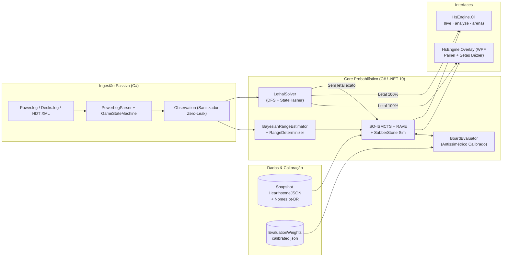

# HsEngine — Engine Probabilística de Decisão para Hearthstone

O **HsEngine** é um motor probabilístico de tomada de decisão para Hearthstone (formato **Padrão**), inspirado em *solvers* de poker de informação imperfeita (GTO Wizard / PioSOLVER). Como o Hearthstone combina **informação oculta** (mão e baralho do oponente) e **aleatoriedade intra-turno** (compras, *Discover*, mísseis e gatilhos), não existe uma árvore determinística única: o motor infere o **range bayesiano** do oponente, amostra mundos consistentes e calcula a **Win Equity (`Win%`)**, o **intervalo de confiança de 95%** e a **probabilidade de letal (`Lethal%`)** de cada linha do turno.

---

## Principais Capacidades

- **Ingestão Passiva e Segura (`HsEngine.Ingestion`, [ADR-0005](docs/architecture/adr-0005-modo-offline-e-ingestao.md)):**
  - Leitura estritamente passiva do `Power.log`, `Decks.log` e `PlayerDecks.xml` do Hearthstone Deck Tracker (zero leitura de memória do processo, zero injeção, zero automação de cliques/teclado).
  - Sanitizador rigoroso de informação oculta (`Observation`): nenhuma entidade não revelada do baralho ou segredo inimigo atravessa a fronteira de observação.
  - Detecção automática da instalação do Hearthstone via registro do Windows, processos ativos e drives locais (`LogLocator`).
- **Inferência Bayesiana de Range e Deckstrings (`HsEngine.Search` / `HsEngine.Simulation`, [ADR-0006](docs/architecture/adr-0006-range-e-avaliacao.md)):**
  - Codec completo de deckstrings oficiais Base64 varint (`DeckStringCodec`) e casamento automático do seu baralho ativo (`DeckMatcher`).
  - Atualização bayesiana $P(\text{arquétipo} \mid \text{classe}, \text{cartas reveladas})$ sobre catálogo de arquétipos das 11 classes + ponderação por slot da mão inimiga considerando *keeps* de mulligan e idade de retenção (`TurnEnteredHand`).
- **Busca Híbrida: Lethal Solver Exato + SO-ISMCTS com RAVE (`HsEngine.Search`, [ADR-0004](docs/architecture/adr-0004-busca-ismcts-turno.md)):**
  - **Lethal Solver:** DFS exato com tabela de transposição estrutural (`StateHasher` estilo Zobrist, ~10–14x mais rápido que hash textual) e validação multi-seed de determinismo. Curto-circuita o MCTS em milissegundos quando há letal 100% garantido.
  - **SO-ISMCTS (*Single-Observer Information Set MCTS*):** UCB ciente de disponibilidade combinado com **RAVE/AMAF** no escopo do turno, backup robusto misto de Coulom, expansão progressiva em 3 níveis (priorizando ações geradoras de informação), deduplicação posicional (`BoardPlacement`), quebra de simetria de lacaios gêmeos e poda de alvos estritamente dominados.
  - **Probabilidade Estocástica de Letal:** contabiliza a probabilidade empírica de vitória no próprio turno para linhas dependentes de RNG ou compras (ex.: *Mísseis Arcanos*, *Intelecto Arcano*).
- **Suporte ao Formato Padrão (`HsEngine.Simulation`, [ADR-0008](docs/architecture/adr-0008-padrao-com-proxy-de-cartas.md)):**
  - Aliasing automático de reimpressões do Core (preservando rebalanceamentos de custo/atributos e sub-opções `Choose One`), compilador conservador de efeitos de texto (`CardEffectCompiler`) para feitiços, Gritos de Guerra e Últimos Suspiros não ambíguos do Padrão, e fallback transparente por proxies de atributos/palavras-chave.
- **Overlay Transparente In-Game em WPF (`HsEngine.Overlay`, [ADR-0009](docs/architecture/adr-0009-overlay-no-jogo.md)):**
  - Janela transparente *click-through* (`WS_EX_TRANSPARENT | WS_EX_NOACTIVATE`) com DPI `PerMonitorV2` e ancoragem `HWND_TOPMOST` sobre o cliente Unity (compatível com Hearthstone Deck Tracker e monitores 16:9, 16:10 e 21:9 ultrawide).
  - **Fase 1:** painel em português (`pt-BR`) com nomes oficiais traduzidos das cartas, `Win%`, `Lethal%`, range estimado do oponente e linha alternativa.
  - **Fase 2:** anéis luminosos e setas curvas de Bézier sobre mão, lacaios, heróis, poder heroico e botão de encerrar turno, avançando passo a passo conforme você executa a jogada.
- **Analisador Pós-Jogo Estilo GTO Wizard & Pipeline Python (`HsEngine.Cli analyze`, `analysis/`, [ADR-0002](docs/architecture/adr-0002-pipeline-offline-python.md)):**
  - Reconstrói todos os seus turnos de um `Power.log` gravado, compara a jogada feita com a linha ótima da engine e classifica desvios de EV (`Ótima`, `Imprecisão`, `Erro`, `Blunder`).
  - Pipeline offline em Python para snapshot enxuto do HearthstoneJSON (`tools/cards/`) e calibração logística via *Platt scaling* / IRLS com verificação de `ECE < 5 p.p.` (`analysis/calibration.py`).

---

## Arquitetura



Documentação arquitetural completa em [docs/architecture/README.md](docs/architecture/README.md) (`ARCH-0001` e `ADR-0001` a `ADR-0009`).

---

## Pré-requisitos

- **.NET SDK 10.0+** (`net10.0` para o motor multiplataforma e `net10.0-windows` para o `HsEngine.Overlay`).
- **Python 3.11+** com `pytest` (opcional, apenas para atualizar snapshots de cartas e rodar o pipeline offline de calibração).
- **Hearthstone com logs ativados** no `log.config` (`%LOCALAPPDATA%\Blizzard\Hearthstone\log.config` — se você já usa o **Hearthstone Deck Tracker**, isso já está habilitado automaticamente).

---

## Como Usar

### 1. Overlay Visual Dentro do Jogo (Recomendado)

Com o Hearthstone aberto, execute:

```powershell
dotnet run -c Release --project src/HsEngine.Overlay
```

Opções úteis:
- `--logs "E:\Battle.net\Hearthstone\Logs"`: informa manualmente a pasta `Logs` (por padrão detectada automaticamente).
- `--deck "AAECA..."`: informa explicitamente o código Base64 do seu deck (caso contrário, o motor casa automaticamente via `Decks.log` e `PlayerDecks.xml` do HDT).
- `--time-ms 3000`: orçamento de tempo por recomendação em milissegundos (padrão: `3000`).
- `--workers 12`: número de árvores paralelas no SO-ISMCTS (padrão: núcleos lógicos da CPU).
- `--always-visible`: mantém o painel visível mesmo quando o Hearthstone está em segundo plano.

### 2. Recomendador ao Vivo no Terminal

```powershell
dotnet run -c Release --project src/HsEngine.Cli -- live --time-ms 3000 --top 3
```

### 3. Analisador Pós-Jogo de Replays (Estilo GTO Wizard)

Analisa a última partida gravada (ou um arquivo `Power.log` específico) e aponta erros de EV turno a turno:

```powershell
dotnet run -c Release --project src/HsEngine.Cli -- analyze --time-ms 1500
dotnet run -c Release --project src/HsEngine.Cli -- analyze --log "caminho\para\Power.log" --turn 9
```

### 4. Arena de Validação Empírica e Exportação para Calibração

Executa partidas espelhadas (com troca de assento para cancelar vantagem de iniciativa) entre o agente `SO-ISMCTS` e a política `Greedy`:

```powershell
dotnet run -c Release --project src/HsEngine.Cli -- arena --deals 50 --iterations 200 --seed 1000 --out docs/benchmarks/arena/run.csv --samples-out docs/benchmarks/arena/samples.csv
```

### 5. Pipeline Offline em Python (Calibração Platt Scaling / ECE e Cartas)

```powershell
# Ajustar escala logística Win% = sigma(scale * score) e validar ECE < 5 p.p.:
python analysis/calibration.py --input docs/benchmarks/arena/samples.csv --output data/weights/calibrated.json

# Atualizar snapshot enxuto e nomes pt-BR do HearthstoneJSON:
python tools/cards/snapshot_cards.py --build latest --output data/cards
```

---

## Testes e Benchmarks

| Critério (`ARCH-0001 §2.2`) | Meta | Resultado Verificado | Relatório |
|---|---|---|---|
| **Arena SO-ISMCTS × Greedy** (espelho c/ troca de assento) | `≥ 60,0%` | **`68,0%`** (`82,0%` Assento 1 · `54,0%` Assento 2) | [2026-11-18-arena-e-calibracao.md](docs/benchmarks/2026-11-18-arena-e-calibracao.md) |
| **Calibração da Win Equity (ECE)** | `< 5,00 p.p.` | **`4,45 p.p.`** (`Brier = 0,2018`, `4.162` amostras) | [data/weights/calibrated.json](data/weights/calibrated.json) |
| **Throughput de Clone + Ação** (`SabberStone`) | `< 50 µs` | **`~7,1 µs`** (`~4,4–6,1 µs` para `StateHasher`) | [2026-10-31-clone-baseline.md](docs/benchmarks/2026-10-31-clone-baseline.md) |
| **Suíte Automatizada de Testes** | `0` falhas / `0` avisos | **`245` testes aprovados** (`238` xUnit .NET + `7` pytest) | `TreatWarningsAsErrors = true` |

```powershell
# Suíte completa .NET (xUnit — Ingestão, Simulação, Avaliação, Busca e Overlay):
dotnet test HsEngine.sln -c Release

# Suíte Python (snapshot e calibração Platt/ECE):
$env:PYTHONPATH="analysis;tools/cards"; python -m pytest tools/cards analysis

# Microbenchmarks de clone/hash/simulação (BenchmarkDotNet):
dotnet run -c Release --project bench/HsEngine.Benchmarks -- --filter '*' --job short
```

---

## Estrutura do Repositório

| Caminho | Responsabilidade |
|---|---|
| `src/HsEngine.Core/` | Contratos base compartilhados |
| `src/HsEngine.Ingestion/` | Parser de `Power.log`, máquina de estados, `Observation` (zero-leak) e `LogLocator` |
| `src/HsEngine.Simulation/` | Adaptador do SabberStone, `ProxyCards`, `CardEffectCompiler`, `DeckLibrary`, `StateHasher` |
| `src/HsEngine.Evaluation/` | `BoardEvaluator` antissimétrico e `EvaluationWeights` calibrados |
| `src/HsEngine.Search/` | `LethalSolver`, `Ismcts` (SO-ISMCTS + RAVE), `BayesianRangeEstimator`, `TurnPlanner`, `ReplayAnalyzer`, `Arena` |
| `src/HsEngine.Overlay/` | Overlay transparente WPF (`PerMonitorV2`, painel pt-BR e geometria/setas Bézier) |
| `src/HsEngine.Cli/` | CLI para `live`, `analyze` e `arena` |
| `analysis/` | Calibração logística (*Platt scaling*) e cálculo de ECE / Brier score em Python |
| `tools/cards/` | Extrator de snapshots enxutos e traduções `pt-BR` do HearthstoneJSON |
| `tests/` | Suítes xUnit de todos os módulos e golden files de `Power.log` |
| `docs/` | `ARCH-0001`, `ADR-0001..0009` e relatórios de benchmark |
