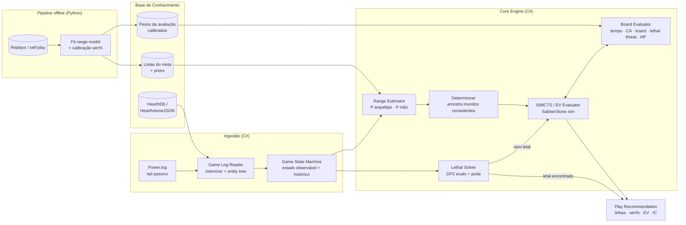

# ARCH-0001 — Fase 1: Arquitetura e Viabilidade

## 0. TL;DR (decisões propostas)

| # | Decisão | Proposta | Confiança |
|---|---------|----------|-----------|
| D1 | Linguagem do Core | **C# / .NET 8+** (core + simulação) | Alta |
| D2 | Linguagem de dados/ML offline | **Python** (range model, calibração, notebooks) | Alta |
| D3 | Motor de regras | **SabberStone (fork)** + **HearthDb/HearthstoneJSON** para metadados | Média — ver risco R1 |
| D4 | Algoritmo de busca | **Turn-level ISMCTS** com determinização + avaliação no fim do turno + *lethal solver* exato antes | Alta |
| D5 | Ingestão | **Leitura passiva de `Power.log`** (sem leitura de memória, sem input automatizado) | Alta |
| D6 | MVP | **Offline, pool de cartas fechado, decks conhecidos** — sem leitura ao vivo na primeira fatia | Alta |

O maior risco do projeto **não é algoritmo nem performance**: é **cobertura de cartas**. Ver §1.4.

---

## 1. Seleção de Stack

### 1.1 Critérios (ponderados)

1. **Motor de regras existente** (requisito: não codificar cartas à mão) — peso máximo.
2. Throughput de simulação (clone de estado + aplicação de ação) — é o gargalo do MCTS.
3. Integração com o ecossistema de ingestão (HDT, HearthDb, parsers de `Power.log`).
4. Velocidade de iteração / TDD.

### 1.2 Comparativo

| Critério | C# / .NET | C++ / Rust | Python |
|---|---|---|---|
| Motor de regras pronto | **SabberStone** (C#, o simulador aberto mais completo) | Nenhum maduro → reescrever regras (viola o requisito) | **Fireplace** (cobertura menor e desatualizada) |
| Metadados de cartas | **HearthDb** nativo; HearthstoneJSON | HearthstoneJSON (parse manual) | HearthstoneJSON |
| Parser de `Power.log` | Parser do HDT / HearthSim (C#) reaproveitável | Reescrever | `python-hslog` (HearthSim) |
| Throughput MCTS | Bom (JIT, `struct`, `Span<T>`, pooling, `Parallel`) — tipicamente 2–5x abaixo de C++ bem otimizado | Máximo | 1–2 ordens de grandeza abaixo; inviável no budget de 5–15 s |
| Plugin HDT (overlay futuro) | Nativo | Via interop | Via processo externo |
| Iteração / testes | xUnit + BenchmarkDotNet | Mais lento | Mais rápido |

### 1.3 Recomendação

**Híbrido: C#/.NET para tudo que roda em tempo de decisão; Python apenas para o pipeline offline de dados.**

- O argumento decisivo é o requisito "não codificar regras": o único motor de regras aberto suficientemente completo é C#. Escolher Rust/C++ significa reimplementar o jogo — meses de trabalho que não validam a tese do produto.
- A diferença de performance C# vs. C++ é constante, não assintótica. Em MCTS, a qualidade da recomendação é dominada por **avaliação e determinização**, não por 2–3x a mais de iterações.
- Python fica com o que faz bem: ajustar o modelo de *range* (Bayes sobre arquétipos), calibrar a função de avaliação (regressão logística → win%), análises. A fronteira é por **artefatos serializados** (JSON/ONNX), não chamadas em tempo real.

**Rota de escape de performance:** se o benchmark (§3.4) mostrar clone de estado como gargalo inaceitável, a otimização é dentro do C# (estado compacto em `struct`, *undo* em vez de clone), não troca de linguagem.

### 1.4 Risco R1 — cobertura de cartas (crítico)

- SabberStone e Fireplace **pararam de acompanhar as expansões** há anos. Nenhum cobre o Standard atual.
- HearthDb / HearthstoneJSON estão atualizados, mas trazem **metadados** (custo, ataque, texto, tags), não **comportamento**.
- Consequência: "não codificar regras" e "Standard completo" são, hoje, **requisitos incompatíveis**. Para jogar Standard, alguém terá que implementar o comportamento das cartas novas — em um fork do SabberStone ou numa camada própria.
- Mitigação proposta: MVP restrito ao pool que o SabberStone já implementa; decisão sobre o caminho para Standard fica na Pergunta 1 (§6).

---

## 2. Escopo do MVP (Vertical Slice)

### 2.1 Princípio

Validar **a tese do produto** (a engine ranqueia linhas melhor que heurísticas simples) eliminando, na primeira fatia, as três maiores fontes de complexidade: **ingestão ao vivo**, **cobertura de cartas** e **incerteza de arquétipo**.

### 2.2 Slice 0 — "Solver de laboratório" (proposto como MVP)

| Dimensão | Escopo |
|---|---|
| Modo | **Offline**: entrada = snapshot de estado (JSON) ou estado gerado em self-play |
| Pool de cartas | Subconjunto de ~60–100 cartas **Classic/Core já implementadas e testadas no SabberStone**, priorizando minions vanilla + efeitos simples (battlecry de dano, taunt, charge, divine shield) |
| Decks | 2–4 decks fixos com lista **conhecida** pelo oponente modelado |
| Informação oculta | Apenas **ordem do deck + mão** do oponente (range = combinações da lista conhecida menos cartas vistas) — sem inferência de arquétipo |
| Saída | Top-N linhas do turno com **Win Equity estimada**, **EV** (score de avaliação), **intervalo de confiança** e nº de simulações |
| Budget | 5 s e 15 s (dois perfis) |

**Critério de aceite (mensurável):**
1. Agente ISMCTS vence agente *greedy* (melhor ação imediata por heurística) em **≥ 60%** de 1.000 partidas espelhadas, com troca de lado.
2. *Lethal solver* encontra 100% dos letais em uma suíte de puzzles construída à mão.
3. Win Equity calibrada: erro de calibração (ECE) < 5 p.p. em partidas de self-play.
4. Determinismo: mesma seed → mesma recomendação (requisito para TDD).

### 2.3 Slices seguintes (fora do MVP, para planejamento)

| Slice | Adiciona | Valida |
|---|---|---|
| 1 | **Ingestão de `Power.log`** em paralelo ao Slice 0, testada contra logs gravados (golden files) | Reconstrução de estado correta |
| 2 | **Range de arquétipo** (Bayes sobre listas do meta) | Inferência de informação oculta |
| 3 | Advisor sobre logs reais, pool de cartas limitado | Integração ponta a ponta |
| 4 | Expansão de cartas (depende da decisão R1) | Aplicabilidade real |

Arena é **pior** candidato a MVP do que parece: pool enorme e variado, decks desconhecidos e sem lista de meta — maximiza exatamente as incertezas que queremos eliminar primeiro.

---

## 3. Componentes e Fluxo de Dados

### 3.1 Diagrama



### 3.2 Contratos entre componentes

| Componente | Entrada | Saída | Observação |
|---|---|---|---|
| **Game Log Reader** | linhas de `Power.log` | eventos tipados (`TagChange`, `FullEntity`, `ShowEntity`, `Block`…) | Sem estado de jogo; puramente sintático. Testado com golden files. |
| **Game State Machine** | eventos | `ObservableState` (imutável por snapshot) + `History` (turno em que cada carta entrou na mão, mulligan, cartas jogadas, *created-by*) | Fonte de verdade da **informação observável**. Nunca contém informação que o jogador não veria na tela. |
| **Range Estimator** | `ObservableState`, `History`, priors do meta | distribuição sobre arquétipos e marginais por carta na mão do oponente | Bayes: P(arq \| cartas reveladas, classe) → P(mão \| arq, idade das cartas, mulligan). |
| **Determinizer** | estado + range | K mundos completos (`Game` do SabberStone) | Amostragem consistente com tudo observado (cartas vistas, contagem de mão/deck). |
| **Lethal Solver** | estado | sequência letal ou `None` | Exato, curto-circuita o MCTS. Com aleatoriedade, reporta a probabilidade do letal em vez de um sim/não. |
| **ISMCTS** | K mundos, budget | árvore sobre **ações do nosso turno** | Ver §3.3. |
| **Board Evaluator** | estado no fim do turno do oponente | score ∈ ℝ → win% via sigmoide calibrada | Começa heurístico com pesos; vira modelo aprendido depois. |
| **Recommendation** | estatísticas da raiz | top-N linhas, win%, EV, IC 95%, nº de visitas | Formato estilo solver: mostrar distribuição, não só a melhor jogada. |

### 3.3 Núcleo matemático — por que ISMCTS em nível de turno

**Problema:** um turno de Hearthstone é uma **sequência** de ações (jogar carta, atacar, hero power, escolher alvo, discover) com fator de ramificação combinatório, aleatoriedade intra-turno e informação oculta.

**Abordagem proposta:**

1. **Lethal check exato** primeiro (DFS com poda e *transposition table*). Barato e de alto valor.
2. **SO-ISMCTS** (Single-Observer Information Set MCTS):
   - Cada iteração amostra uma **determinização** do range → resolve informação oculta.
   - A árvore é indexada por **ações**, não por estado, então estatísticas são compartilhadas entre determinizações. É isso que torna o método adequado sob informação imperfeita, ao contrário de *Perfect Information Monte Carlo* puro, que sofre de *strategy fusion*.
   - Nós de **chance** para efeitos aleatórios (alvos aleatórios, discover): amostrados, não expandidos.
   - Profundidade: **até o fim do nosso turno + turno do oponente simulado por política leve** (greedy/heurística), depois **avaliação estática**. Rollouts até o fim do jogo são caros e ruidosos em Hearthstone; os agentes fortes do *Hearthstone AI Competition* combinam busca rasa com boa avaliação de estado.
3. **Redução de ramificação:** ordenação canônica de ações comutativas (ex.: dois ataques independentes), *progressive widening* e poda heurística de ações dominadas (ex.: trocar um 1/1 em um 8/8 sem ganho).
4. **Minimax/alpha-beta**: descartado como núcleo — não lida bem com chance + informação oculta, e o fator de ramificação inviabiliza profundidade útil. Fica restrito ao lethal solver (busca de um jogador só).

**EV vs. Win Equity:**
- **EV** = média do score de avaliação sobre as simulações que passaram pela linha.
- **Win Equity** = σ(a·score + b), com (a, b) calibrados por regressão logística sobre resultados reais/self-play.
- Exibir também a **variância** da linha: duas jogadas com a mesma equity e riscos diferentes são decisões diferentes (análogo ao poker).

### 3.4 Performance e budget

- **Anytime:** a raiz sempre tem uma recomendação; mais tempo = mais confiança. Recomendação preliminar em ~1 s, refinada até o budget.
- **Paralelismo:** *root parallelization* — cada thread trabalha em determinizações próprias e as árvores são somadas no fim. Encaixa naturalmente em ISMCTS e evita locks.
- **Gargalo esperado:** clone do `Game` do SabberStone. A primeira tarefa técnica do Slice 0 é um **benchmark** (BenchmarkDotNet) de clone + aplicação de ação, para medir iterações/s reais antes de projetar mais nada.
- **Pré-computação** durante o turno do oponente (ponderar a árvore para os estados mais prováveis do nosso próximo turno).

### 3.5 Ingestão e ToS (D5)

- **Prática aceita no ecossistema HDT/Firestone:** ler `Power.log` passivamente (habilitado via `log.config`).
- **Fora de escopo, por decisão de projeto:** leitura/injeção de memória do processo, automação de input, qualquer interação com o cliente ou servidores.
- **Fair-play:** o `Power.log` às vezes expõe informação que o jogador não vê na tela. A `Game State Machine` deve **descartar explicitamente** qualquer dado oculto ao jogador (com teste dedicado). A engine só usa o que um humano atento poderia saber.
- Recomendação em tempo real durante ranked é uma **zona cinzenta** de ToS — ver Pergunta 2.

---

## 4. Estrutura de repositório proposta (Slice 0)

```
/src
  HsEngine.Core/           # contratos: ObservableState, Action, Recommendation
  HsEngine.Simulation/     # adaptador do SabberStone (fork como submódulo)
  HsEngine.Search/         # LethalSolver, Ismcts, Determinizer
  HsEngine.Evaluation/     # BoardEvaluator, calibração
  HsEngine.Ingestion/      # LogReader, GameStateMachine (Slice 1)
  HsEngine.Cli/            # recebe snapshot JSON, imprime ranking
/tests
  HsEngine.*.Tests/        # xUnit; puzzles de letal; golden Power.logs
/bench
  HsEngine.Benchmarks/     # BenchmarkDotNet (clone, iter/s)
/analysis                  # Python: range model, calibração, notebooks
/docs/architecture         # este documento + ADRs
```

**TDD:** a primeira suíte é de **puzzles de letal** (estado → sequência letal esperada) e de **invariantes do simulador** (clone é independente do original; mesma seed → mesmo resultado). A engine de busca só entra quando esses testes estiverem verdes.

---

## 5. Registro de riscos

| ID | Risco | Impacto | Mitigação |
|---|---|---|---|
| R1 | Simulador sem cartas do Standard atual | Bloqueia uso real | MVP em pool fechado; decisão estratégica na Pergunta 1 |
| R2 | Throughput de clone do SabberStone insuficiente | Baixa qualidade em 5–15 s | Benchmark na semana 1; otimização de clone/undo no fork |
| R3 | Sem acesso a dados de meta (API do HSReplay é restrita) | Range model fraco | Priors de listas públicas + replays próprios; Pergunta 3 |
| R4 | Função de avaliação mal calibrada | Win% enganosa | Calibração com ECE como métrica de aceite |
| R5 | Ambiguidade de ToS em uso ao vivo | Risco à conta do usuário | Modo offline/review primeiro; Pergunta 2 |
| R6 | Vazamento de informação oculta via log | Engine "trapaceia" | Filtro explícito + teste de não-vazamento |

---

## 6. Perguntas de Alinhamento (bloqueiam `status: accepted`)

1. **Estratégia de cobertura de cartas (R1).** Aceitamos que o MVP rode só no pool já implementado pelo SabberStone? E, para chegar ao Standard, a direção é (a) manter um fork do SabberStone implementando as cartas novas, (b) construir uma camada de regras própria guiada por HearthDb, ou (c) aceitar o produto como ferramenta de estudo em formatos/pools suportados? Isso define o custo do projeto mais do que qualquer outra escolha.

2. **Modo de produto: advisor ao vivo vs. analisador pós-jogo.** O alvo final é recomendação **durante** partidas ranqueadas (overlay HDT, zona cinzenta de ToS) ou **revisão pós-jogo / modo estudo** (o uso principal do GTO Wizard)? Proponho começar por revisão de replays: mesmo core, zero risco de conta e sem pressão de latência.

3. **Fonte de dados para os ranges.** Temos acesso a dados agregados de meta (API do HSReplay, parceria, dataset público) ou o range model será construído a partir de replays próprios + listas públicas? Isso decide se o Range Estimator é bayesiano com priors fortes ou um modelo mais simples.

4. **Função de avaliação: heurística vs. aprendida, e hardware alvo.** Aceitamos começar com avaliação heurística calibrada (rápida, interpretável) e migrar para um modelo aprendido via self-play (exige dataset, possivelmente GPU e inferência ONNX no C#) apenas depois do Slice 0? Qual é a máquina alvo para o budget de 5–15 s (nº de núcleos)?

---

## 7. Resultado do alinhamento (2026-10-31)

**Revisão (Antigravity):** R1, stack, critérios de aceite e ToS aprovados. Busca: `Ajustar`, priorizar ações geradoras de informação ([ADR-0004](adr-0004-busca-ismcts-turno.md)).

**Decisões do PO:**

| Pergunta | Decisão | ADR |
|---|---|---|
| 1. Cobertura de cartas | MVP no pool Classic/Core do SabberStone; depois, só cartas-chave de arquétipos tier 1 | [ADR-0003](adr-0003-motor-de-regras-sabberstone.md) |
| 2. Modo de produto | Laboratório offline / analisador pós-jogo | [ADR-0005](adr-0005-modo-offline-e-ingestao.md) |
| 3. Dados de range | Listas públicas (Vicious Syndicate / HSReplay free) + Bayes sobre cartas vistas e retenção | [ADR-0006](adr-0006-range-e-avaliacao.md) |
| 4. Avaliação / hardware | Heurística calibrada no Slice 0; desktop x64 com 8–16 threads | [ADR-0006](adr-0006-range-e-avaliacao.md) |

## 8. Próximos passos após alinhamento

1. Converter D1–D6 em ADRs individuais (`docs/architecture/adr-000X-*.md`) e registrar no `ai-memory`.
2. Fork do SabberStone + benchmark de clone (R2).
3. Suíte de puzzles de letal (TDD) → Lethal Solver.
4. ISMCTS + avaliador heurístico → critério de aceite do Slice 0.
